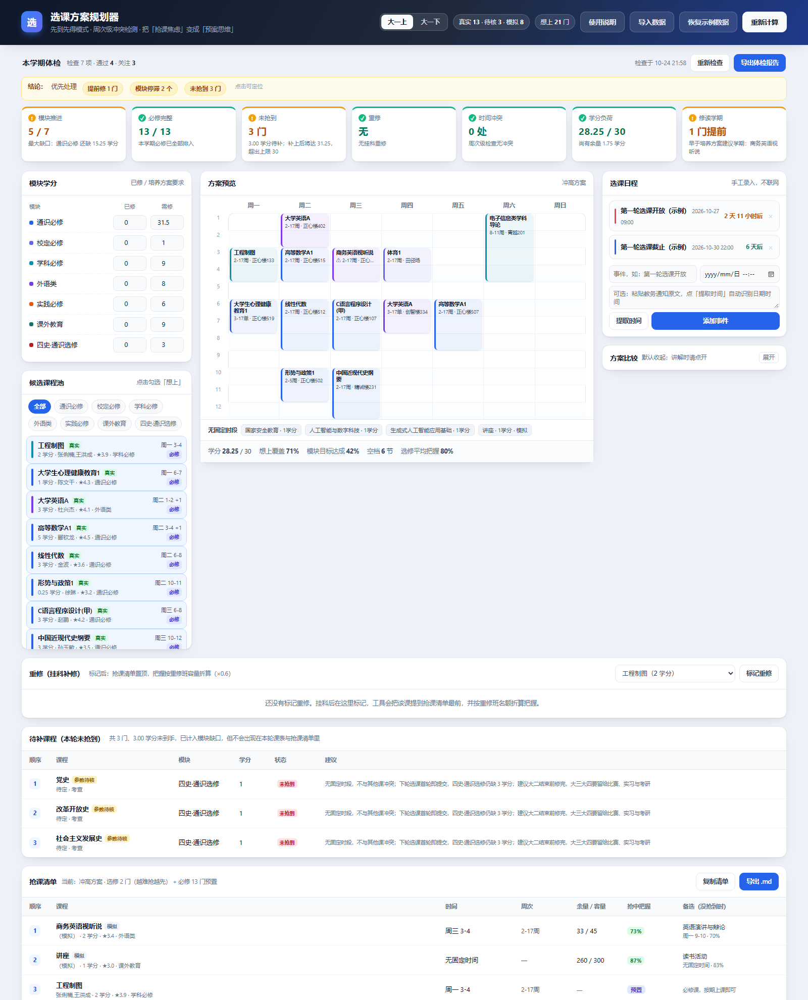

# 选课方案规划器

> 它不帮你抢课，它先告诉你哪里有问题。

面向大学生的**修读计划检查器**：在每学期选课前，按培养方案逐项核对模块学分、检测周次级时间冲突、标出未抢到与挂科重修的课程，并把结论导出成一份可以拿走的体检报告。

本作品为**杭州电子科技大学第二届 AIGC 应用创新大赛（赛题一）**参赛作品。

**在线演示：** `https://<你的用户名>.github.io/<仓库名>/`（开启 GitHub Pages 后填写；或直接打开 `index.html`）



---

## 这是什么

一个**单文件网页**，纯前端运行，零依赖、零安装、无服务端、不联网。

打开后先给结论，再给依据：

- **本学期体检**：7 项检查逐条判定（✓ 通过 / ! 关注 / × 不通过），一句话说明"优先处理什么"，点标签可跳到对应区块
- **模块学分**：按培养方案的 7 个模块逐项对账，显示要求、已修与缺口
- **周次课表**：把"周次"纳入冲突判断——同节次但周次不重叠的两门课可以叠加，不再误判冲突
- **三套方案**：冲高 / 稳妥 / 保底，比较选修之间的取舍（默认收起，避免干扰主判断）
- **抢课清单**：按"重修 → 选修 → 其余必修"排序，每门附一个可替代的备选
- **待补与重修**：未抢到的课单列并计算"补上之后会不会超学分上限"；挂科的课可标记重修，自动置顶
- **选课日程**：粘贴教务通知原文自动提取时间，生成倒计时
- **数据导入 / 备份迁移**：CSV 导入自己的课表与培养方案；JSON 备份在设备之间搬运全部设置

## 这不是什么

| 它不是 | 原因 |
|---|---|
| 抢课脚本 | 不联网、不访问教务系统、不代替人执行，只做本地排布与提醒 |
| 培养方案阅读器 | 不解释方案，而是把方案的要求编码进校验逻辑 |
| 云端应用 | 没有服务端，也就没有账号、没有同步、没有数据出口 |

## 快速开始

```bash
# 方式一：直接双击
index.html

# 方式二：本地起个静态服务（可选）
python -m http.server 8000
# 然后访问 http://localhost:8000
```

推荐 Chrome / Edge 最新版。数据保存在浏览器 `localStorage`，换设备请用「导入数据 → 备份与迁移」搬运。

## 数据来源与真实性分级

界面与文档里的每个数字都有出处，分三级标注：

| 级别 | 内容 | 来源 |
|---|---|---|
| **真实** | 13 门课程的课程名、教师、周次、地点、学分、考核方式 | 本人课表 |
| **真实** | 7 个模块的最低学分要求、课程性质、课程号、考核方式 | 专业执行计划（培养方案） |
| **待核** | 四史课程（党史/改革开放史/社会主义发展史）的学分与开课学期 | 默认假设（1 学分/门、每学期开课） |
| **模拟** | 各课程的容量与已选人数、教师口碑 | 无公开来源，演示用 |

容量与口碑之所以是模拟的，是因为它们没有公开数据源，而抓取教务系统既违规也不可靠。**解法是"导入"**：使用者可以把查到的真实名额填进去，工具从"我算得准"变成"按你给的条件算"。

## 合规边界

这份工具**刻意不做**四件事：

1. 不模拟登录，不接触账号与密码
2. 不发起自动化请求，不对教务系统造成任何压力
3. 不抓取通知，时间由用户手工录入
4. 不占用名额，只做排布，不代替人执行

全文无 `fetch` / `XMLHttpRequest` / `WebSocket`，可以自己搜。

## AIGC 使用声明

依据大赛要求如实说明：

- **AI 生成**：页面结构、样式、全部交互脚本、PDF 解析脚本、项目文档与 PPT 的初稿、模拟数据
- **本人完成**：需求判断、真实数据的获取与核对（纠正过 4 处归属错误）、测试用例与结果验证、合规边界确认、视频录制与答辩

详见 [`docs/项目文档.docx`](docs/项目文档.docx) 附录 A。

## 目录结构

```
.
├── index.html              # 应用本体（单文件，无依赖）
├── docs/
│   ├── 项目文档.docx        # 参赛项目文档（含 AI 使用声明等六项附录）
│   ├── 项目方案.pptx        # 参赛演示 PPT
│   ├── 迭代日志.docx        # 22 节迭代记录，含失败与自我更正
│   └── 体检报告示例.txt      # 导出的体检报告样例
└── screenshots/
    ├── 主界面.png
    ├── 体检区.png
    ├── 使用说明.png
    └── 数据导入.png
```

## 已知局限

- 容量与口碑没有公开来源，只能估算或由使用者录入
- 只覆盖两个学期，尚未推演完整四年
- 未建模课程之间的先修依赖（如高数 A1 → A2）
- 无账号与跨设备同步，靠 JSON 备份搬运

这些不是没想到，是还没做完，逐条记在迭代日志的缺口清单里。

## 许可

MIT License，见 [LICENSE](LICENSE)。
